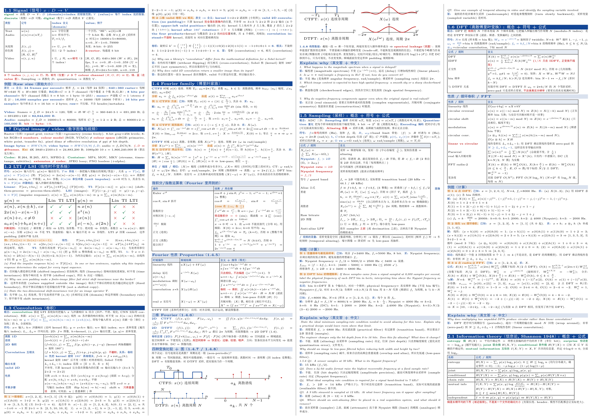
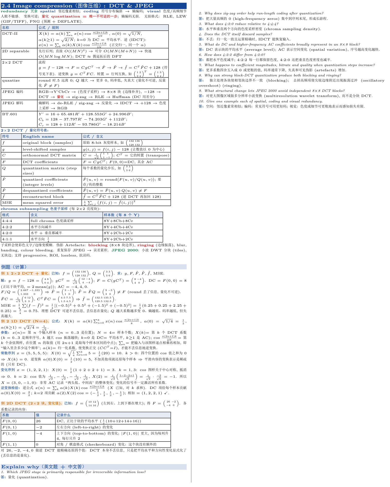

# dense-cheatsheet-latex：港硕/海外硕 理工科考试 Cheat Sheet 制作skills

## 适用范围

理工科（数学、物理、工程、计算机、统计等）的期中/期末考试

## 成品示例

以下是主包某堂课自己做的 cheat sheet（A4 横向，正文约 3.8pt）。图中只是为了展示版式。



## 排版规范

### 每节的固定顺序

1. **概念与符号**：包含该节的基础概念（中英文）与参数含义。
2. **公式与对比表**：核心公式、方法对比，方便记忆。
3. **例题（计算题）**：用“已知 / 求 / 解”，每一步写成“公式 → 代入 → 数值 → 结果”，过程表（如算法 trace）保持和讲义一致。
4. **例题（名词解释/原因题）**：英文题目 + 中英文解答，放在每节最后。

下图是其中一节（“2.4 Image compression”）的实际排版：



### 页面

- A4 横向，页边距 2 mm，**4 栏**，栏间有细竖线；用 `multicols*` 自然流动，不手动分栏，内容在栏与栏、页与页之间连续排下去。
- 正文字号由 `build.py` 在页数限制内自动选最大值（示例为 3.8pt，行距约为字号的 1.13 倍）；标题条字号固定，不随正文缩放。
- 不使用方框（box），一律用**彩色横条**分层，省空间且不打断阅读。


### 层级


| 层级      | 样式      | 用途                              |
| ------- | ------- | ------------------------------- |
| `\sect` | 深蓝底白字大条 | 对应讲义的一节，例如“2.2 Codes & Huffman” |
| `\sub`  | 浅蓝底蓝字小条 | 节内的小块，例如“例题（计算）”“Explain why”   |
| `\Eg`   | 橙色底的标签  | 标明一道例题的开始                       |


考场上查东西时，先找节（蓝条），再找符号或公式（表格），最后才需要看例题，查找路径固定，不用在页面里“搜”。

### 颜色约定

- 蓝色加粗 `\B`：公式、关键结论
- 红色加粗 `\R`：易错点、陷阱
- 绿色加粗 `\G`：定义、术语
- 橙色底 `\Eg`：例题标签


### 中英文分布


| 位置          | 语言                                               | 示例                             |
| ----------- | ------------------------------------------------ | ------------------------------ |
| 节标题         | 中英文都给：英文术语 + 中文名                                 | “2.2 Codes & Huffman（前缀码与哈夫曼）” |
| 概念说明、解释     | 中文为主，难翻译或考试会用到的术语，在**括号里附英文**                    | “欠采样 (undersampling)”          |
| 符号表         | 符号 + **英文名** + 中文含义/公式                           | “$C$ \| DCT matrix \| …”         |
| 公式、计算       | 数学符号，不夹杂文字                                       | “$H=-\sum p\log_2p$”           |
| 例题          | 已知 / 求 / 解 用中文，数值和符号照原样                          |                                |
| Explain why | **题目保留英文原文**（和考题一致），**答案用中文**，难术语括号内附英文，不写整段英文答案 |                                |


原则：英文只出现在“考试里会以英文出现”或“中文翻译会歧义”的地方，其余用中文以节省版面。语言策略可以按需调整（全英文或全中文）。

### 删减与取舍

不写来源标记（如“HW1 P3a”）；纯描述性、没有公式/数字/陷阱的段落删除；同一方法只保留一个例题；确实放不下时才缩小字号。详见 `references/style-guide.md`。

## 安装

**直接让codex/claude code/cursor clone这个仓库自己安装就ok了**

## 使用

将所有的有关讲义/syllabus/homework丢给你的 agent，然后对智能体说：“根据这些讲义和作业做一份期中 cheat sheet，限 2 页。”

## 工作流概览

1. **盘点**：提取讲义文字，列出每节的 Learning objectives、作业和往年题。
2. **约定**：和用户确认页数、语言、最小可读字号、是否需要 explain-why 答案。
3. **起草**：每个讲义小节写一个 `\sect`，按固定顺序填内容。
4. **排版**：运行 `build.py` 自动选字号。
5. **检查**：渲染成图片，看是否有截断、空栏、孤立标题。
6. **补漏**：对照 Learning objectives，补上缺失项后重新排版。

## 通用性说明

- 技能里没有任何科目专属的公式、术语或题目；颜色约定、表格、例题和 explain-why 的写法适用于各类需要公式与计算的课程。
- 语言策略可配置：默认中文说明 + 难术语括号内附英文，可按用户需求改成全英文或全中文。
- 页数、字号范围、栏数都是脚本参数，不依赖特定考试规定。


## 目录结构

```
SKILL.md                    工作流与写作约定（智能体读取）
assets/template.tex         模板：宏、颜色条、表格、示例小节
scripts/build.py            自动选字号 + 栏填充率报告
scripts/render.py           PDF 转 PNG 预览
references/style-guide.md   表格/例题模板、删减顺序、覆盖度检查
examples/                   成品页面截图（README 展示用）
```


## 许可

MIT